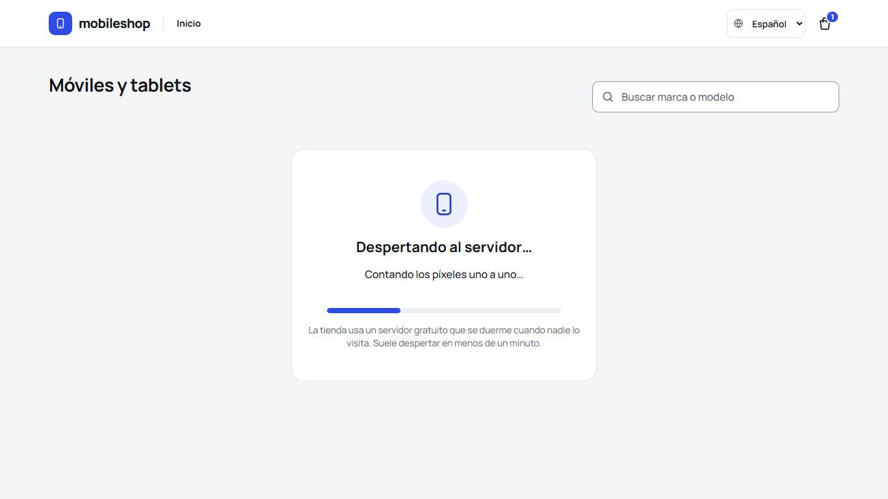
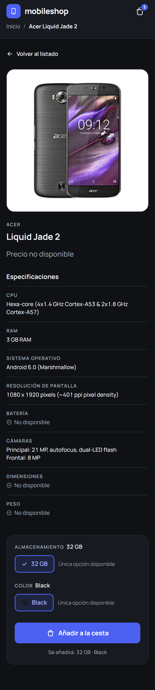
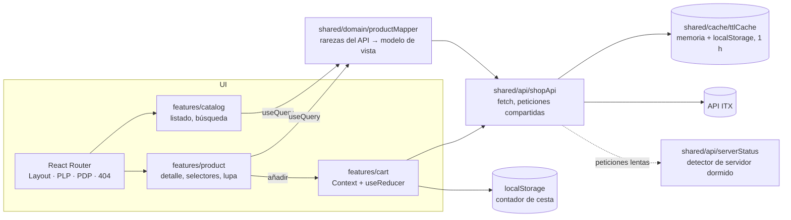

# mobile-shop-spa

[English](README.md) · [](https://github.com/kintstoner/mobile-shop-spa/actions/workflows/ci.yml)

Aplicación de una sola página para ver y comprar móviles: listado de productos con búsqueda en tiempo real, página de
detalle con selectores de color y almacenamiento, y contador de cesta en la cabecera, sobre el
[API de la prueba de front-end de ITX](https://itx-frontend-test.onrender.com). En español e inglés.

React 19 + TypeScript + Vite, enrutado en cliente con React Router (sin SSR ni MPA).

**Demo: <https://kintstoner.github.io/mobile-shop-spa/>** (se publica en GitHub Pages en cada push a `main`).


## Ejecutar

Requisitos: Node 22+.

```bash
npm install
npm start          # servidor de desarrollo en http://localhost:5173
npm run build      # comprobación de tipos + build de producción en dist/
npm test           # 152 tests (Vitest + Testing Library + MSW)
npm run lint       # oxlint + comprobación de Prettier
npm run test:e2e   # 6 tests e2e de Playwright sobre el build de producción (una vez: npx playwright install chromium)
```

Configuración opcional (ver `.env.example`):

| Variable                  | Por defecto                              | Significado                                                          |
| ------------------------- | ---------------------------------------- | -------------------------------------------------------------------- |
| `VITE_API_BASE_URL`       | `https://itx-frontend-test.onrender.com` | Raíz del API                                                         |
| `VITE_CACHE_TTL_MS`       | `3600000` (1 hora)                       | Vida de cada respuesta del API en caché                              |
| `VITE_CACHE_MAX_STALE_MS` | `86400000` (24 horas)                    | Cuánto tiempo se puede mostrar un dato caducado mientras se revalida |

El API está en un hosting gratuito que se duerme cuando no se usa: **la primera carga puede tardar hasta un minuto**
(medido: 52 s). La app lo detecta y muestra una pantalla de espera (ver abajo); las cargas siguientes salen de la
caché del cliente.

## Funcionalidad

Lo que pide el enunciado:

- **Listado (PLP)**: todos los productos del API con imagen, marca, modelo y precio; 1/2/3/4 columnas según el ancho,
  nunca más de cuatro. La búsqueda filtra en tiempo real por marca y modelo (sin distinguir mayúsculas ni acentos,
  deben aparecer todas las palabras), guarda la consulta en la URL y tiene estado vacío.
- **Detalle (PDP)**: dos columnas (imagen / detalles y acciones), enlace de vuelta a los mismos resultados de
  búsqueda, los once atributos pedidos (marca, modelo y precio en la cabecera; CPU, RAM, sistema operativo,
  resolución de pantalla, batería, cámaras, dimensiones y peso en las especificaciones) y "No disponible" para los
  valores que faltan.
- **Acciones**: selectores de almacenamiento y color siempre visibles; una opción única viene preseleccionada. El
  botón de añadir espera a que se elijan ambas y envía `{ id, colorCode, storageCode }`.
- **Cabecera**: logo que enlaza al listado, migas (`Inicio / Marca Modelo`) y el contador de cesta en todas las
  vistas, persistido entre recargas y pestañas.
- **Caché en cliente** de cada respuesta del API durante una hora.

Lo que necesita una tienda real además (revisada como tienda online):

- **Botón de añadir visible sin hacer scroll**: la columna del detalle va precio → opciones y botón →
  especificaciones; en el móvil, una barra con el precio y el botón se queda fija abajo mientras el botón principal no
  se ve.
- **Lupa**: la foto se amplía alrededor del ratón, y un clic o un toque la abre a pantalla completa.
- **Servidor dormido, explicado**: las fotos muestran un marcador con brillo hasta que llegan; si el servidor tarda
  más de 3 s, aparece una pantalla de espera con una barra de progreso estimada y frases simpáticas (o, si ya hay
  datos en caché, un aviso pequeño).
- **Botón de la cesta**: al pulsarlo avisa de que la página de la cesta está en desarrollo (toast amarillo) en vez de
  no hacer nada.
- **Español e inglés** (i18n), elegidos desde la cabecera; la primera vez se usa el idioma del navegador.
- **Estados**: skeletons durante la carga, errores con reintento (incluido el 500 del API para un producto que no
  existe), página de no encontrado y error boundary para fallos de render.
- **Tema claro y oscuro**, usable con teclado y lector de pantalla (Lighthouse accesibilidad 100).

| Esperando al servidor                                       | Detalle en el móvil, con la barra de compra fija        |
| ----------------------------------------------------------- | ------------------------------------------------------- |
|  |  |

## Arquitectura



```
src/
├── app/                    composición: App, rutas, providers, layout, páginas de la app
│   ├── layout/             Layout, Header, Breadcrumbs, LanguageSelect
│   ├── pages/              NotFoundPage, RouteError (error boundary)
│   └── providers/          AppProviders
├── features/               una carpeta por feature, cada una con un index.ts público
│   ├── catalog/            pages/ProductListPage · components/{ProductCard, SearchBar, EmptySearch}
│   │                       hooks/{useProducts, useProductSearch} · model/searchProducts
│   ├── product/            pages/ProductDetailPage · components/{ProductHeading, ProductActions, OptionSelector,
│   │                       ProductSpecs, ProductImageZoom, ProductCrumb} · hooks/useProduct
│   └── cart/               components/CartBadge · context/{CartContext, CartProvider} · model/{cartReducer, cartStorage}
├── shared/                 capa base, no sabe nada de las features
│   ├── api/                cliente HTTP, ShopApi, tipos del API, useQuery, ApiContext, serverStatus
│   ├── cache/              ttlCache
│   ├── domain/             tipos del modelo de vista (solo datos, sin textos), productMapper, price, colorSwatch
│   ├── i18n/               configuración de i18next, claves tipadas, useFormatPrice
│   └── ui/                 ErrorMessage, Skeleton, ProductImage, Toast, Lightbox, ServerWaking, icons
├── locales/                es.json, en.json: todos los textos de la interfaz
├── styles/                 tokens de diseño y estilos globales
├── test/                   servidor y handlers de MSW, fixtures reales del API, helper renderApp
├── config.ts               configuración por entorno con valores por defecto
└── main.tsx
e2e/                        tests e2e de Playwright
design/                     exportación de Claude Design
```

Cada componente vive en su carpeta con sus estilos y tests. Los imports usan el alias `@/`. Las dependencias van en
un solo sentido, `app → features → shared`, y una feature usa otra solo a través de su `index.ts`; el lint lo
obliga (ADR 9).

## Decisiones de diseño

Resumen en [docs/DECISIONS.es.md](docs/DECISIONS.es.md); cada una tiene un ADR en [docs/adr](docs/adr). En breve:

- **SPA con Vite + React 19 + React Router (declarativo)**: lo que pide el enunciado, nada más.
- **Caché TTL propia** (memoria + localStorage, una hora por entrada; el dato caducado se muestra al instante mientras
  se revalida en segundo plano; peticiones simultáneas compartidas, los fallos no se cachean).
- **Contador de cesta en el cliente**: el API siempre responde `count: 1` a los navegadores (ver abajo).
- **Un mapper para las rarezas del API**, con tests contra datos reales; devuelve solo datos y la interfaz traduce.
- **Tokens de Claude Design + CSS Modules**, sin librería de UI.
- **Tests de la app entera sobre datos grabados del API**, tests e2e y una pasada de QA en navegador real.
- **oxlint** en lugar de ESLint, que no admite la toolchain actual.
- **Carpetas por feature con dependencias en un solo sentido** (`app → features → shared`), obligadas por el lint.
- **i18n con react-i18next**, claves tipadas y un test que mantiene los dos idiomas al día.
- **El servidor dormido se detecta con lo que ya está en curso**, nunca haciendo ping al API (eso anularía la caché).

## El API real, tal como es

El enunciado muestra ejemplos tipo `id: 0001`; el API real es distinto. Cada punto se comprobó con `curl` y sobre los
100 productos, y cada uno está tratado (ADR 4):

| Hallazgo                                                                           | Tratamiento                                                                                            |
| ---------------------------------------------------------------------------------- | ------------------------------------------------------------------------------------------------------ |
| `price` es un string, vacío en 6 productos                                         | "Precio no disponible", nunca "€" ni NaN                                                               |
| `displayResolution` y `displaySize` cruzados en todos los productos                | La resolución se toma del campo que casa con `W x H pixels`                                            |
| Claves `dimentions`, `secondaryCmera`                                              | Mapeadas de forma explícita, tipadas en `shared/api/types.ts`                                          |
| Campos que son string o array (partidos por comas)                                 | Se vuelven a unir con ", "                                                                             |
| Valores ausentes como `""` o `"-"`                                                 | "No disponible"                                                                                        |
| Un id inexistente responde **500**, no 404                                         | Error amable con reintento y enlace al listado                                                         |
| Peso sin unidad; dos almacenamientos llamados `" "`; colores en texto libre        | Se añade " g"; "Sin especificar"; muestra según palabras de color                                      |
| `POST /api/cart` cuenta por cookie de sesión, pero el CORS es `*` sin credenciales | El navegador nunca envía la cookie: **siempre `count: 1`**. El contador se lleva en el cliente (ADR 3) |
| El hosting gratuito se duerme                                                      | La primera petición tardó 52 s; pantalla de espera, marcadores en las fotos y caché (ADR 11)           |
| Las fotos miden unos 160 × 212 px                                                  | La lupa se queda en 2× y el visor en unos 2,5×; más allá solo se verían píxeles                        |

## Cómo se ha probado

**152 tests automáticos** (`npm test`), la mayoría pintando la app entera en una URL con MSW respondiendo como el API
real (con fixtures grabados de él):

| Área                    | Tests                                                                                        | Qué cubren                                                                                                                                                                                                                                                                           |
| ----------------------- | -------------------------------------------------------------------------------------------- | ------------------------------------------------------------------------------------------------------------------------------------------------------------------------------------------------------------------------------------------------------------------------------------ |
| Caché y cliente del API | `ttlCache` (10), `shopApi` (14), `serverStatus` (6)                                          | Caducidad justo a la hora, supervivencia a recargas, storage corrupto o lleno, acierto de caché sin petición, revalidación pasada una hora (reloj falso), dato caducado disponible para revalidar, petición en vuelo compartida, fallos sin cachear, detección de operaciones lentas |
| Datos e idioma          | `productMapper` (21), `price` (7), `colorSwatch` (10), `searchProducts` (7), `i18n` (5)      | Cada rareza de la tabla anterior; precios por idioma; reglas de palabras, mayúsculas y acentos de la búsqueda; mismas claves y ningún texto vacío en los dos idiomas, idioma inicial                                                                                                 |
| Listado                 | `ProductListPage` (8), `ProductSearch` (5), `ProductImage` (4)                               | Carga, 100 tarjetas, nombres accesibles, precio ausente, error y reintento, caché caducada mostrada al instante, filtro en tiempo real, consulta en la URL, estado vacío, marcador e imagen de respaldo                                                                              |
| Detalle y cesta         | `ProductDetailPage` (7), `ProductActions` (12), `ProductImageZoom` (4), modelo de cesta (10) | Especificaciones, título de la página, error 500, vuelta a la misma búsqueda, preselección, botón inactivo, códigos enviados, contador en cliente, botón antes de las especificaciones, barra fija (añade o lleva a la opción que falta), visor con ratón y teclado                  |
| App                     | `Header` (7), `LanguageSelect` (2), `Toast` (4), servidor dormido (5), rutas (4)             | Migas, contador en todas las vistas, toast de la cesta, cambio de idioma (precios incluidos, recordado), pantalla de espera con progreso y frases que avanzan, aviso con datos en caché, 404, enlace de salto, fallo de render                                                       |

Los tests escritos después del código se comprobaron rompiéndolo a propósito (límite de caducidad de la caché,
deduplicación de peticiones en vuelo, stale-while-revalidate): cada rotura hizo fallar un test. Las consultas van por
rol y nombre accesible, y una encontró un fallo real (una tarjeta se leía "AcerIconia Talk S" en un lector de
pantalla).

**Tests end-to-end** (`npm run test:e2e`, Playwright, también en CI): el build de producción en un Chromium real, con el
API simulado a partir de los mismos datos grabados para no depender de un servidor que se duerme. Cubren búsqueda →
detalle → añadir → contador mantenido tras recargar, como máximo cuatro columnas a 1440 px y una a 390 px, la lupa
ampliando la foto bajo el ratón y el visor, una segunda visita servida desde la caché sin llamar al API, abrir
directamente la URL de un producto y un producto inexistente. El test de columnas se comprobó cambiando el grid a
cinco columnas: falló.

**Pasada de QA en navegador real** (MCP de Chrome DevTools, API real): maquetación a 1440, 1366 × 768, 390 y 320 px,
búsqueda, añadir a la cesta con el `POST` real, contador tras recargar, id inexistente, acierto de caché (0 peticiones
al recargar) y revalidación forzando la caducidad, un retraso de 20 s en el API para ver la pantalla de espera, temas
claro y oscuro, Lighthouse accesibilidad 100. Informe: [docs/qa](docs/qa/qa-report.es.md).

| Detalle                                      | Listado en móvil                                     | Producto inexistente                     |
| -------------------------------------------- | ---------------------------------------------------- | ---------------------------------------- |
|  |  |  |

**CI** (GitHub Actions) ejecuta lint, tests unitarios y de integración, build y los tests e2e de Playwright en cada
push; un segundo workflow publica el build en GitHub Pages.

## Limitaciones conocidas

- La cesta es un contador, no una cesta: el API no da a un navegador forma de leer ni mantener una cesta en servidor
  (ADR 3). El botón de la cesta lo avisa.
- Las fotos del API son pequeñas (unos 160 × 212 px): la lupa no puede mostrar más detalle del que tienen.
- La detección del servidor dormido es una heurística (más de 3 s): con una conexión muy lenta se ve el mismo aviso.
- Los textos propios del API (especificaciones, nombres de color) se muestran tal como llegan, en inglés, en los dos
  idiomas.
- i18next añade unos 18 kB comprimidos al bundle (129 kB en total).

## Desarrollo asistido por IA

Construido con **Claude Code** (Anthropic) como programador en pareja, y con **Claude Design** para el diseño visual
antes de escribir código: el tablero de tokens y los tableros interactivos de listado y detalle de [`design/`](design)
se iteraron allí, y la implementación los sigue.

- **Qué hizo la IA**: analizó el API real (los 100 productos) antes de programar, generó el código y los tests
  guiado por tests (cada test se vio fallar primero, o se comprobó contra un error introducido a propósito), hizo la
  pasada de QA en Chrome a través de DevTools (capturas, red, caché, Lighthouse) y redactó la documentación.
- **Qué se decidió y comprobó a mano**: el propio diseño, las mejoras de UX de tienda (compra visible sin scroll,
  lupa, pantalla de espera, toast de la cesta, dos idiomas), las versiones y las contrapartidas de los ADRs, el
  comportamiento en el navegador, y cada línea de este README y de los ADRs.
- **Guardarraíles**: 152 tests automáticos sobre datos reales del API, 6 tests e2e, TypeScript estricto, claves de
  traducción tipadas, lint que falla con avisos y obliga las capas, CI en cada push y la pasada de QA en navegador.
