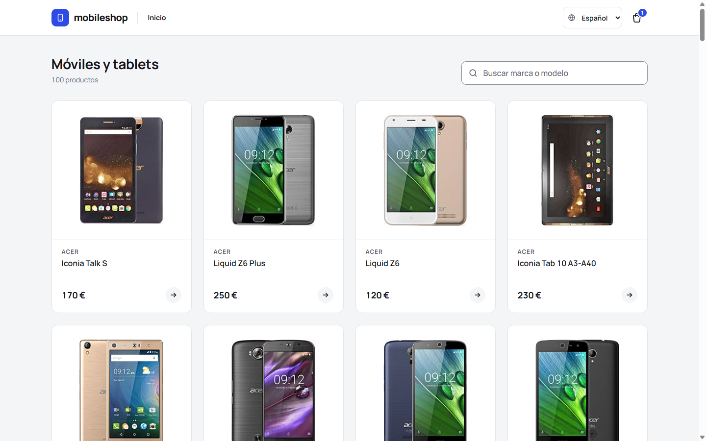
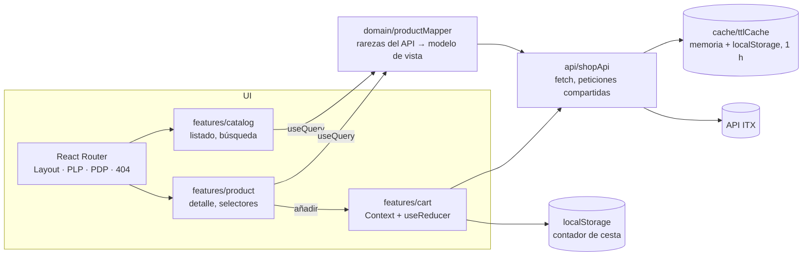
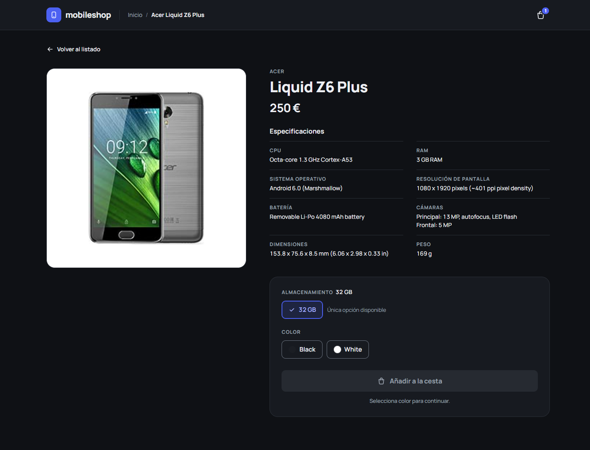
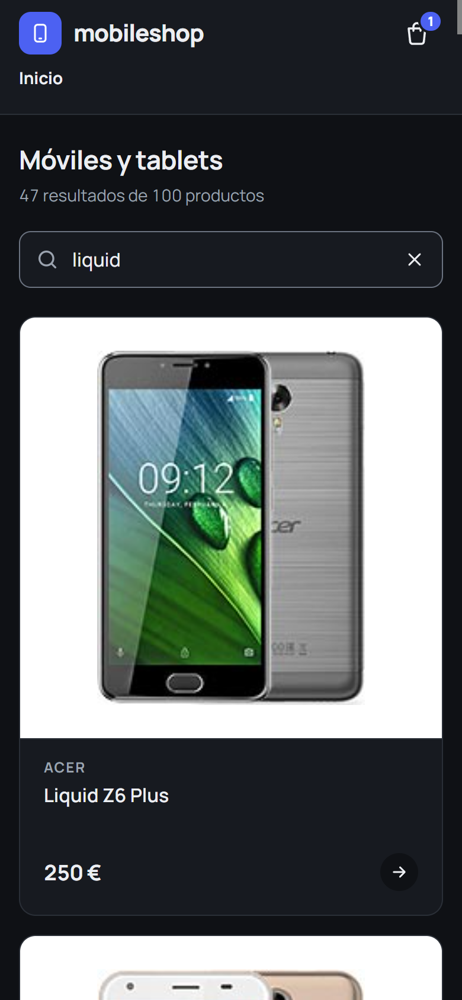
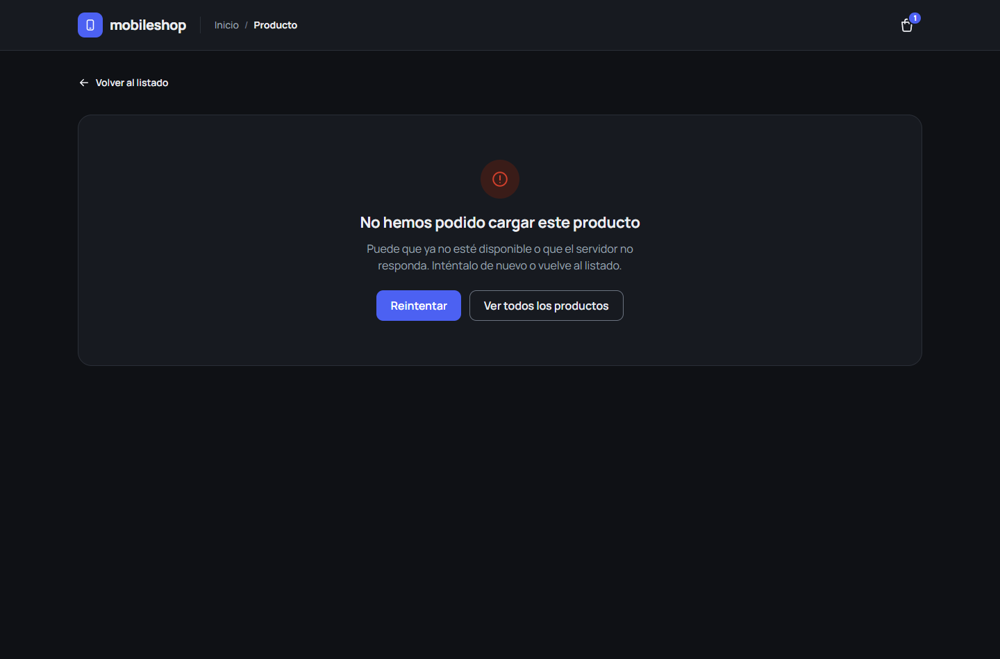

# mobile-shop-spa

[English](README.md)

Aplicación de una sola página para ver y comprar móviles: listado de productos con búsqueda en tiempo real, página de
detalle con selectores de color y almacenamiento, y contador de cesta en la cabecera, sobre el
[API de la prueba de front-end de ITX](https://itx-frontend-test.onrender.com).

React 19 + TypeScript + Vite, enrutado en cliente con React Router (sin SSR ni MPA).

**Demo: <https://kintstoner.github.io/mobile-shop-spa/>** (se publica en GitHub Pages en cada push a `main`).



## Ejecutar

Requisitos: Node 22+.

```bash
npm install
npm start          # servidor de desarrollo en http://localhost:5173
npm run build      # comprobación de tipos + build de producción en dist/
npm test           # 117 tests (Vitest + Testing Library + MSW)
npm run lint       # oxlint + comprobación de Prettier
npm run test:e2e   # 5 tests e2e de Playwright sobre el build de producción (una vez: npx playwright install chromium)
```

Configuración opcional (ver `.env.example`):

| Variable                  | Por defecto                              | Significado                                                          |
| ------------------------- | ---------------------------------------- | -------------------------------------------------------------------- |
| `VITE_API_BASE_URL`       | `https://itx-frontend-test.onrender.com` | Raíz del API                                                         |
| `VITE_CACHE_TTL_MS`       | `3600000` (1 hora)                       | Vida de cada respuesta del API en caché                              |
| `VITE_CACHE_MAX_STALE_MS` | `86400000` (24 horas)                    | Cuánto tiempo se puede mostrar un dato caducado mientras se revalida |

El API está en un hosting gratuito que se duerme cuando no se usa: **la primera carga puede tardar hasta un minuto**
(medido: 52 s). La app lo avisa a los 5 s de espera; las cargas siguientes salen de la caché del cliente.

## Funcionalidad

- **Listado (PLP)**: todos los productos del API con imagen, marca, modelo y precio; 1/2/3/4 columnas según el ancho,
  nunca más de cuatro. La búsqueda filtra en tiempo real por marca y modelo (sin distinguir mayúsculas ni acentos,
  deben aparecer todas las palabras), guarda la consulta en la URL y tiene estado vacío.
- **Detalle (PDP)**: dos columnas (imagen / descripción y acciones), enlace de vuelta a los mismos resultados de
  búsqueda, los once atributos pedidos (marca, modelo y precio en la cabecera; CPU, RAM, sistema operativo,
  resolución de pantalla, batería, cámaras, dimensiones y peso en las especificaciones) y "No disponible" para los
  valores que faltan.
- **Acciones**: selectores de almacenamiento y color siempre visibles; una opción única viene preseleccionada. El
  botón de añadir espera a que se elijan ambas y envía `{ id, colorCode, storageCode }`.
- **Cabecera**: logo que enlaza al listado, migas (`Inicio / Marca Modelo`) y el contador de cesta en todas las
  vistas, persistido entre recargas y pestañas.
- **Estados**: skeletons durante la carga, errores con reintento (incluido el 500 del API para un producto que no
  existe), página de no encontrado y error boundary para fallos de render.
- **Tema claro y oscuro**, usable con teclado y lector de pantalla (Lighthouse accesibilidad 100).

## Arquitectura



| Carpeta          | Contenido                                                                                      |
| ---------------- | ---------------------------------------------------------------------------------------------- |
| `src/app`        | App, rutas, providers, contexto del API                                                        |
| `src/api`        | Cliente HTTP, `ShopApi` (lecturas cacheadas, POST de la cesta), tipos del API, hook `useQuery` |
| `src/cache`      | Caché TTL de dos capas                                                                         |
| `src/domain`     | Tipos del modelo de vista, mapper de los datos del API, muestras de color                      |
| `src/features`   | `catalog` (listado, tarjeta, búsqueda), `product` (detalle, descripción, selectores), `cart`   |
| `src/components` | Cabecera, migas, contador, layout, skeleton, errores, imagen de producto, iconos               |
| `src/styles`     | Tokens de diseño y estilos globales                                                            |
| `src/test`       | Servidor y handlers de MSW, **fixtures reales del API**, helper de render                      |
| `design/`        | Exportación de Claude Design (tablero de tokens, tableros de listado y detalle)                |

## Decisiones de diseño

Resumen en [docs/DECISIONS.es.md](docs/DECISIONS.es.md); cada una tiene un ADR en [docs/adr](docs/adr). En breve:

- **SPA con Vite + React 19 + React Router (declarativo)**: lo que pide el enunciado, nada más.
- **Caché TTL propia** (memoria + localStorage, una hora por entrada; el dato caducado se muestra al instante mientras se revalida en segundo plano; peticiones simultáneas
  compartidas, los fallos no se cachean).
- **Contador de cesta en el cliente**: el API siempre responde `count: 1` a los navegadores (ver abajo).
- **Un mapper para las rarezas del API**, con tests contra datos reales.
- **Tokens de Claude Design + CSS Modules**, sin librería de UI.
- **Tests de la app entera sobre datos grabados del API**, más una pasada de QA en navegador real.
- **oxlint** en lugar de ESLint, que no admite la toolchain actual.

## El API real, tal como es

El enunciado muestra ejemplos tipo `id: 0001`; el API real es distinto. Cada punto se comprobó con `curl` y sobre los
100 productos, y cada uno está tratado (ADR 4):

| Hallazgo                                                                           | Tratamiento                                                                                            |
| ---------------------------------------------------------------------------------- | ------------------------------------------------------------------------------------------------------ |
| `price` es un string, vacío en 6 productos                                         | "Precio no disponible", nunca "€" ni NaN                                                               |
| `displayResolution` y `displaySize` cruzados en todos los productos                | La resolución se toma del campo que casa con `W x H pixels`                                            |
| Claves `dimentions`, `secondaryCmera`                                              | Mapeadas de forma explícita, tipadas en `api/types.ts`                                                 |
| Campos que son string o array (partidos por comas)                                 | Se vuelven a unir con ", "                                                                             |
| Valores ausentes como `""` o `"-"`                                                 | "No disponible"                                                                                        |
| Un id inexistente responde **500**, no 404                                         | Error amable con reintento y enlace al listado                                                         |
| Peso sin unidad; dos almacenamientos llamados `" "`; colores en texto libre        | Se añade " g"; "Sin especificar"; muestra según palabras de color                                      |
| `POST /api/cart` cuenta por cookie de sesión, pero el CORS es `*` sin credenciales | El navegador nunca envía la cookie: **siempre `count: 1`**. El contador se lleva en el cliente (ADR 3) |
| El hosting gratuito se duerme                                                      | La primera petición tardó 52 s; aviso de carga lenta y caché                                           |

## Cómo se ha probado

**117 tests automáticos** (`npm test`), la mayoría pintando la app entera en una URL con MSW respondiendo como el API
real (con fixtures grabados de él):

| Área                    | Tests                                                                               | Qué cubren                                                                                                                                                                                                                                                              |
| ----------------------- | ----------------------------------------------------------------------------------- | ----------------------------------------------------------------------------------------------------------------------------------------------------------------------------------------------------------------------------------------------------------------------- |
| Caché y cliente del API | `ttlCache` (10), `shopApi` (14)                                                     | Caducidad justo a la hora, supervivencia a recargas, storage corrupto o lleno, acierto de caché sin petición, revalidación pasada una hora (reloj falso), dato caducado disponible para revalidar, petición en vuelo compartida, fallos sin cachear, cuerpo de la cesta |
| Mapeo de datos          | `productMapper` (25), `colorSwatch` (10), `searchProducts` (7)                      | Cada rareza de la tabla anterior; reglas de palabras, mayúsculas y acentos de la búsqueda                                                                                                                                                                               |
| Listado                 | `ProductListPage` (8), `ProductSearch` (5), `ProductImage` (3)                      | Carga, 100 tarjetas, nombres accesibles, precio ausente, error y reintento, caché caducada mostrada al instante y mantenida si falla la revalidación, filtro en tiempo real, consulta en la URL, estado vacío, imagen de respaldo                                       |
| Detalle y cesta         | `ProductDetailPage` (7), `ProductActions` (7), `cartReducer` (4), `cartStorage` (6) | Especificaciones, valores ausentes, título de la página, error 500, vuelta a la misma búsqueda, preselección, botón inactivo, códigos enviados, contador en cliente, fallo, teclado                                                                                     |
| App                     | `Header` (6), rutas (3), error boundary (1), `App` (1)                              | Migas, contador en todas las vistas y tras recargar, página 404, aviso de carga lenta, enlace de salto, fallo de render                                                                                                                                                 |

Los tests escritos después del código se comprobaron rompiéndolo a propósito (límite de caducidad de la caché,
deduplicación de peticiones en vuelo): cada rotura hizo fallar un test. Las consultas van por rol y nombre accesible,
y una encontró un fallo real (una tarjeta se leía "AcerIconia Talk S" en un lector de pantalla).

**Tests end-to-end** (`npm run test:e2e`, Playwright, también en CI): el build de producción en un Chromium real, con el
API simulado a partir de los mismos datos grabados para no depender de un servidor que se duerme. Cubren búsqueda →
detalle → añadir → contador mantenido tras recargar, como máximo cuatro columnas a 1440 px y una a 390 px (CSS que jsdom
no puede comprobar), una segunda visita servida desde la caché sin llamar al API, abrir directamente la URL de un
producto y un producto inexistente. El test de columnas se comprobó cambiando el grid a cinco columnas: falló.

**Pasada de QA en navegador real** (MCP de Chrome DevTools, API real): maquetación a 1440 y 390 px, búsqueda, añadir a
la cesta con el `POST` real, contador tras recargar, id inexistente, acierto de caché (0 peticiones al recargar) y
revalidación forzando la caducidad, temas claro y oscuro, Lighthouse accesibilidad 100. Informe:
[docs/qa](docs/qa/qa-report.es.md).

| Detalle                                      | Móvil                                                | Producto inexistente                     |
| -------------------------------------------- | ---------------------------------------------------- | ---------------------------------------- |
|  |  |  |

**CI** (GitHub Actions) ejecuta lint, tests unitarios y de integración, build y los tests e2e de Playwright en cada push; un segundo workflow publica el build en GitHub Pages
(hay que activar Pages con "GitHub Actions" como origen en la configuración del repositorio).

## Limitaciones conocidas

- La cesta es un contador, no una cesta: el API no da a un navegador forma de leer ni mantener una cesta en servidor
  (ADR 3).
- Las imágenes del API son pequeñas (unos 160 × 212 px) y se ven algo blandas en el detalle.
- La interfaz está solo en español; los textos propios del API (especificaciones, nombres de color) se muestran tal
  como llegan, en inglés.
- No se ha hecho la barra fija de "añadir" para pantallas pequeñas que planteaba el diseño; en móvil el botón va
  después de las especificaciones.

## Desarrollo asistido por IA

Construido con **Claude Code** (Anthropic) como programador en pareja, y con **Claude Design** para el diseño visual
antes de escribir código: el tablero de tokens y los tableros interactivos de listado y detalle de [`design/`](design)
se iteraron allí, y la implementación los sigue.

- **Qué hizo la IA**: analizó el API real (los 100 productos) antes de programar, generó el código y los tests
  guiado por tests (cada test se vio fallar primero, o se comprobó contra un error introducido a propósito), hizo la
  pasada de QA en Chrome a través de DevTools (capturas, red, caché, Lighthouse) y redactó la documentación.
- **Qué se decidió y comprobó a mano**: el propio diseño, las versiones y las contrapartidas de los ADRs, el
  comportamiento en el navegador, y cada línea de este README y de los ADRs.
- **Guardarraíles**: 117 tests automáticos sobre datos reales del API, 5 tests e2e, TypeScript estricto, lint que falla con avisos,
  CI en cada push y la pasada de QA en navegador.
