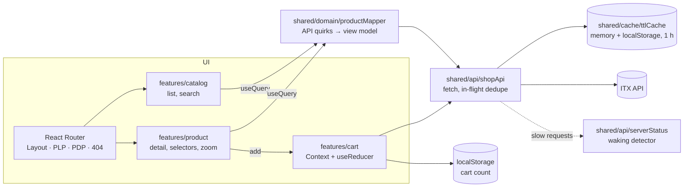

# mobile-shop-spa

[Español](README.es.md) · [](https://github.com/kintstoner/mobile-shop-spa/actions/workflows/ci.yml)

Single-page app to browse and buy mobile phones: a product list with real-time search, a product detail page with
colour and storage selectors, and a cart counter in the header, on top of the
[ITX front-end test API](https://itx-frontend-test.onrender.com). Spanish and English.

React 19 + TypeScript + Vite, client-side routing with React Router (no SSR, no MPA).

**Live demo: <https://kintstoner.github.io/mobile-shop-spa/>** (deployed to GitHub Pages on every push to `main`).


## Run

Requirements: Node 22+.

```bash
npm install
npm start          # development server on http://localhost:5173
npm run build      # type check + production build in dist/
npm test           # 152 tests (Vitest + Testing Library + MSW)
npm run lint       # oxlint + Prettier check
npm run test:e2e   # 6 Playwright smoke tests on the production build (once: npx playwright install chromium)
```

Optional configuration (see `.env.example`):

| Variable                  | Default                                  | Meaning                                                       |
| ------------------------- | ---------------------------------------- | ------------------------------------------------------------- |
| `VITE_API_BASE_URL`       | `https://itx-frontend-test.onrender.com` | API root                                                      |
| `VITE_CACHE_TTL_MS`       | `3600000` (1 hour)                       | Lifetime of each cached API response                          |
| `VITE_CACHE_MAX_STALE_MS` | `86400000` (24 hours)                    | How long expired data may still be shown while it revalidates |

The API runs on a free host that sleeps when idle: the **first load can take up to a minute** (measured: 52 s). The
app detects it and shows a waiting screen (below); later loads come from the client cache.

## Features

What the statement asks for:

- **List (PLP)**: every product from the API, image, brand, model and price; 1/2/3/4 columns by width, never more than
  four. Search filters in real time by brand and model (case and accent insensitive, every word must match), keeps
  the query in the URL, and has an empty state.
- **Detail (PDP)**: two columns (image / details and actions), back link to the same search results, the eleven
  required attributes (brand, model and price in the heading; CPU, RAM, OS, screen resolution, battery, cameras,
  dimensions and weight in the specs), and "No disponible" for missing values.
- **Actions**: storage and colour selectors always shown; a single option is preselected. The add button waits for
  both choices and sends `{ id, colorCode, storageCode }`.
- **Header**: logo linking to the list, breadcrumbs (`Inicio / Brand Model`), and the cart count on every view,
  persisted across reloads and tabs.
- **Client cache** of every API response for one hour.

What a real shop needs on top (reviewed as an online shop):

- **Add button on screen without scrolling**: the detail column reads price → options and button → specifications;
  on phones a bar with the price and the button sticks to the bottom while the main button is off screen.
- **Magnifier**: the product photo zooms in around the mouse, and a click or tap opens it full screen.
- **Sleeping server, explained**: photos show a shimmering placeholder until they arrive; if the server takes more
  than 3 s, a waiting screen with an estimated progress bar and light-hearted messages appears (or, with cached data,
  a small notice).
- **Cart button**: pressing it says the cart page is in progress (yellow toast) instead of doing nothing.
- **Spanish and English** (i18n), chosen from the header; the browser's language is used the first time.
- **States**: skeletons while loading, errors with retry (including the API's 500 for an unknown product), a
  not-found page and an error boundary for rendering bugs.
- **Light and dark themes**, keyboard and screen-reader friendly (Lighthouse accessibility 100).

| Waiting for the server                                  | Detail on a phone, with the sticky buy bar            |
| ------------------------------------------------------- | ----------------------------------------------------- |
|  |  |

## Architecture



```
src/
├── app/                    composition: App, routes, providers, layout, app-level pages
│   ├── layout/             Layout, Header, Breadcrumbs, LanguageSelect
│   ├── pages/              NotFoundPage, RouteError (error boundary)
│   └── providers/          AppProviders
├── features/               one folder per feature, each with a public index.ts
│   ├── catalog/            pages/ProductListPage · components/{ProductCard, SearchBar, EmptySearch}
│   │                       hooks/{useProducts, useProductSearch} · model/searchProducts
│   ├── product/            pages/ProductDetailPage · components/{ProductHeading, ProductActions, OptionSelector,
│   │                       ProductSpecs, ProductImageZoom, ProductCrumb} · hooks/useProduct
│   └── cart/               components/CartBadge · context/{CartContext, CartProvider} · model/{cartReducer, cartStorage}
├── shared/                 base layer, knows nothing about features
│   ├── api/                HTTP client, ShopApi, raw API types, useQuery, ApiContext, serverStatus
│   ├── cache/              ttlCache
│   ├── domain/             view-model types (data only, no text), productMapper, price, colorSwatch
│   ├── i18n/               i18next setup, typed keys, useFormatPrice
│   └── ui/                 ErrorMessage, Skeleton, ProductImage, Toast, Lightbox, ServerWaking, icons
├── locales/                es.json, en.json: every interface text
├── styles/                 design tokens and global styles
├── test/                   MSW server and handlers, real API fixtures, renderApp helper
├── config.ts               environment configuration with defaults
└── main.tsx
e2e/                        Playwright smoke tests
design/                     Claude Design export
```

Each component lives in its own folder with its styles and tests. Imports use the `@/` alias. Dependencies point
one way, `app → features → shared`, and a feature uses another only through its `index.ts`; lint enforces it
(ADR 9).

## Design decisions

Summary in [docs/DECISIONS.md](docs/DECISIONS.md); each one has an ADR in [docs/adr](docs/adr). In short:

- **SPA with Vite + React 19 + React Router (declarative)**: what the statement asks for, nothing more.
- **Own TTL cache** (memory + localStorage, one hour per entry; expired data is shown at once while it revalidates in
  the background; concurrent requests shared, failures not cached).
- **Cart count in the client**: the API always answers `count: 1` to browsers (below).
- **One mapper for the API's quirks**, unit-tested against real data; it returns data only, the UI translates.
- **Claude Design tokens + CSS Modules**, no UI library.
- **Whole-app tests over recorded API data**, end-to-end smoke tests and a real-browser QA pass.
- **oxlint** instead of ESLint, which does not support the current toolchain.
- **Feature folders with one-way dependencies** (`app → features → shared`), enforced by lint.
- **i18n with react-i18next**, typed keys and a test that keeps both languages in step.
- **Sleeping server detected from what is already in flight**, never by pinging the API (that would defeat the
  cache).

## The real API, as found

The statement shows `id: 0001`-style examples; the real API differs. Each point was checked with `curl` and over all
100 products, and each is handled (ADR 4):

| Finding                                                                         | Handling                                                                                           |
| ------------------------------------------------------------------------------- | -------------------------------------------------------------------------------------------------- |
| `price` is a string, empty in 6 products                                        | "Precio no disponible", never "€" or NaN                                                           |
| `displayResolution` and `displaySize` swapped in all products                   | Resolution taken from the field that matches `W x H pixels`                                        |
| Keys `dimentions`, `secondaryCmera`                                             | Mapped explicitly, typed in `shared/api/types.ts`                                                  |
| Fields sometimes string, sometimes array (split on commas)                      | Joined back with ", "                                                                              |
| Missing values as `""` or `"-"`                                                 | "No disponible"                                                                                    |
| Unknown product id answers **500**, not 404                                     | Friendly error with retry and a link to the list                                                   |
| Weight is a bare number; two storages named `" "`; colour names free text       | " g" added; "Sin especificar"; swatch from colour words                                            |
| `POST /api/cart` counts per session cookie, but CORS is `*` without credentials | The browser never sends the cookie: **always `count: 1`**. The count is kept in the client (ADR 3) |
| Free hosting sleeps when idle                                                   | First request took 52 s; waiting screen, photo placeholders and the cache (ADR 11)                 |
| Photos are about 160 × 212 px                                                   | The magnifier stops at 2× and the viewer at about 2.5×, beyond that only pixels show               |

## How it was tested

**152 automated tests** (`npm test`), most of them rendering the whole app at a URL with MSW answering as the real
API (fixtures recorded from it):

| Area                 | Tests                                                                                   | What they cover                                                                                                                                                                                                                                       |
| -------------------- | --------------------------------------------------------------------------------------- | ----------------------------------------------------------------------------------------------------------------------------------------------------------------------------------------------------------------------------------------------------- |
| Cache and API client | `ttlCache` (10), `shopApi` (14), `serverStatus` (6)                                     | Expiry at exactly one hour, reload survival, corrupted or full storage, cache hit without request, revalidation after an hour (fake clock), stale data kept for revalidation, shared in-flight request, failures not cached, slow-operation detection |
| Data and language    | `productMapper` (21), `price` (7), `colorSwatch` (10), `searchProducts` (7), `i18n` (5) | Every quirk in the table above; prices per language; word, case and accent rules of the search; same keys and no empty text in both languages, initial language                                                                                       |
| List                 | `ProductListPage` (8), `ProductSearch` (5), `ProductImage` (4)                          | Loading, 100 cards, accessible card names, missing price, error and retry, expired cache shown at once, real-time filter, URL query, empty state, photo placeholder and fallback                                                                      |
| Detail and cart      | `ProductDetailPage` (7), `ProductActions` (12), `ProductImageZoom` (4), cart model (10) | Specs, page title, 500 error, back to the same search, preselection, inactive button, posted codes, client count, button before the specs, sticky bar (adds or leads to the missing option), viewer open/close by mouse and keyboard                  |
| App                  | `Header` (7), `LanguageSelect` (2), `Toast` (4), sleeping server (5), routing (4)       | Breadcrumbs, badge on every view, cart toast, switching language (prices included, remembered), waiting screen with moving progress and messages, notice with cached data, 404, skip link, render crash                                               |

Tests written after the code were checked by breaking it on purpose (cache expiry boundary, in-flight dedupe,
stale-while-revalidate): each break made a test fail. Queries go by role and accessible name, and one caught a real
bug (a card read "AcerIconia Talk S" to screen readers).

**End-to-end smoke tests** (`npm run test:e2e`, Playwright, also in CI): the production build in a real Chromium,
with the API mocked from the same recorded data so the run does not depend on a host that sleeps. They cover search →
detail → add → count kept after a reload, at most four columns at 1440 px and one at 390 px, the magnifier scaling the
photo under the mouse and the viewer, a second visit served from the cache with no API call, a product URL opened
directly, and an unknown product. The column test was checked by changing the grid to five columns: it failed.

**QA pass in a real browser** (Chrome DevTools MCP, real API): layouts at 1440, 1366 × 768, 390 and 320 px, search,
add to cart with the real `POST`, counter after reload, unknown id, cache hit (0 requests on reload) and revalidation
after forcing the expiry, a 20 s API delay to see the waiting screen, light and dark themes, Lighthouse accessibility 100. Report: [docs/qa](docs/qa/qa-report.md).

| Detail                                      | Mobile list                                     | Unknown product                          |
| ------------------------------------------- | ----------------------------------------------- | ---------------------------------------- |
|  |  |  |

**CI** (GitHub Actions) runs lint, unit and integration tests, build and the Playwright smoke on every push; a second
workflow publishes the build to GitHub Pages.

## Known limitations

- The cart is a counter, not a cart: the API gives a browser no way to read or keep a server cart (ADR 3). The cart
  button says so.
- The API's photos are small (about 160 × 212 px): the zoom cannot show more detail than they have.
- The sleeping-server check is a heuristic (more than 3 s): on a very slow connection it shows the same message.
- The API's own texts (specs, colour names) are shown as they come, in English, in both languages.
- i18next adds about 18 kB gzipped to the bundle (129 kB in total).

## AI-assisted development

Built with **Claude Code** (Anthropic) as a pair programmer, and with **Claude Design** for the visual design before
any code: the token board and the interactive list and detail boards in [`design/`](design) were iterated there,
and the implementation follows them.

- **What the AI did**: profiled the real API (all 100 products) before coding, generated the code and the tests
  test-first (each test seen failing first, or checked against a deliberate bug), ran the QA pass in Chrome through
  DevTools (screenshots, network, cache, Lighthouse) and drafted the documentation.
- **What was decided and checked by hand**: the design itself, the shop UX improvements (buy box above the fold,
  magnifier, waiting screen, cart toast, two languages), the versions and the trade-offs in the ADRs, the behaviour in
  the browser, and every line of this README and the ADRs.
- **Guardrails**: 152 automated tests over real API data, 6 end-to-end smoke tests, strict TypeScript, typed
  translation keys, lint that fails on warnings and enforces the layers, CI on every push, and the browser QA pass.
