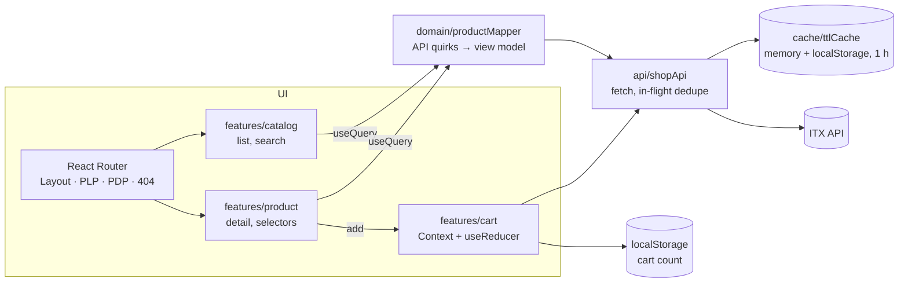

# mobile-shop-spa

[Español](README.es.md)

Single-page app to browse and buy mobile phones: a product list with real-time search, a product detail page with
colour and storage selectors, and a cart counter in the header, on top of the
[ITX front-end test API](https://itx-frontend-test.onrender.com).

React 19 + TypeScript + Vite, client-side routing with React Router (no SSR, no MPA).

**Live demo: <https://kintstoner.github.io/mobile-shop-spa/>** (deployed to GitHub Pages on every push to `main`).


## Run

Requirements: Node 22+.

```bash
npm install
npm start          # development server on http://localhost:5173
npm run build      # type check + production build in dist/
npm test           # 117 tests (Vitest + Testing Library + MSW)
npm run lint       # oxlint + Prettier check
npm run test:e2e   # 5 Playwright smoke tests on the production build (once: npx playwright install chromium)
```

Optional configuration (see `.env.example`):

| Variable                  | Default                                  | Meaning                                                       |
| ------------------------- | ---------------------------------------- | ------------------------------------------------------------- |
| `VITE_API_BASE_URL`       | `https://itx-frontend-test.onrender.com` | API root                                                      |
| `VITE_CACHE_TTL_MS`       | `3600000` (1 hour)                       | Lifetime of each cached API response                          |
| `VITE_CACHE_MAX_STALE_MS` | `86400000` (24 hours)                    | How long expired data may still be shown while it revalidates |

The API runs on a free host that sleeps when idle: the **first load can take up to a minute** (measured: 52 s). The
app says so after 5 s of waiting; later loads come from the client cache.

## Features

- **List (PLP)**: every product from the API, image, brand, model and price; 1/2/3/4 columns by width, never more than
  four. Search filters in real time by brand and model (case and accent insensitive, every word must match), keeps
  the query in the URL, and has an empty state.
- **Detail (PDP)**: two columns (image / description and actions), back link to the same search results, the eleven
  required attributes (brand, model and price in the heading; CPU, RAM, OS, screen resolution, battery, cameras,
  dimensions and weight in the specs), and "No disponible" for missing values.
- **Actions**: storage and colour selectors always shown; a single option is preselected. The add button waits for
  both choices and sends `{ id, colorCode, storageCode }`.
- **Header**: logo linking to the list, breadcrumbs (`Inicio / Brand Model`), and the cart count on every view,
  persisted across reloads and tabs.
- **States**: skeletons while loading, errors with retry (including the API's 500 for an unknown product), a
  not-found page and an error boundary for rendering bugs.
- **Light and dark themes**, keyboard and screen-reader friendly (Lighthouse accessibility 100).

## Architecture



| Folder           | Content                                                                            |
| ---------------- | ---------------------------------------------------------------------------------- |
| `src/app`        | App, routes, providers, API context                                                |
| `src/api`        | HTTP client, `ShopApi` (cached reads, cart post), raw API types, `useQuery` hook   |
| `src/cache`      | Two-layer TTL cache                                                                |
| `src/domain`     | View-model types, mapper for the API's data, colour swatches                       |
| `src/features`   | `catalog` (list, card, search), `product` (detail, description, selectors), `cart` |
| `src/components` | Header, breadcrumbs, cart badge, layout, skeleton, errors, product image, icons    |
| `src/styles`     | Design tokens and global styles                                                    |
| `src/test`       | MSW server and handlers, **real API fixtures**, render helper                      |
| `design/`        | Claude Design export (token board, list and detail boards)                         |

## Design decisions

Summary in [docs/DECISIONS.md](docs/DECISIONS.md); each one has an ADR in [docs/adr](docs/adr). In short:

- **SPA with Vite + React 19 + React Router (declarative)**: what the statement asks for, nothing more.
- **Own TTL cache** (memory + localStorage, one hour per entry; expired data is shown at once while it revalidates in the background; concurrent requests shared,
  failures not cached).
- **Cart count in the client**: the API always answers `count: 1` to browsers (below).
- **One mapper for the API's quirks**, unit-tested against real data.
- **Claude Design tokens + CSS Modules**, no UI library.
- **Whole-app tests over recorded API data**, plus a real-browser QA pass.
- **oxlint** instead of ESLint, which does not support the current toolchain.

## The real API, as found

The statement shows `id: 0001`-style examples; the real API differs. Each point was checked with `curl` and over all
100 products, and each is handled (ADR 4):

| Finding                                                                         | Handling                                                                                           |
| ------------------------------------------------------------------------------- | -------------------------------------------------------------------------------------------------- |
| `price` is a string, empty in 6 products                                        | "Precio no disponible", never "€" or NaN                                                           |
| `displayResolution` and `displaySize` swapped in all products                   | Resolution taken from the field that matches `W x H pixels`                                        |
| Keys `dimentions`, `secondaryCmera`                                             | Mapped explicitly, typed in `api/types.ts`                                                         |
| Fields sometimes string, sometimes array (split on commas)                      | Joined back with ", "                                                                              |
| Missing values as `""` or `"-"`                                                 | "No disponible"                                                                                    |
| Unknown product id answers **500**, not 404                                     | Friendly error with retry and a link to the list                                                   |
| Weight is a bare number; two storages named `" "`; colour names free text       | " g" added; "Sin especificar"; swatch from colour words                                            |
| `POST /api/cart` counts per session cookie, but CORS is `*` without credentials | The browser never sends the cookie: **always `count: 1`**. The count is kept in the client (ADR 3) |
| Free hosting sleeps when idle                                                   | First request took 52 s; slow-load notice and the cache                                            |

## How it was tested

**117 automated tests** (`npm test`), most of them rendering the whole app at a URL with MSW answering as the real
API (fixtures recorded from it):

| Area                 | Tests                                                                               | What they cover                                                                                                                                                                                                                        |
| -------------------- | ----------------------------------------------------------------------------------- | -------------------------------------------------------------------------------------------------------------------------------------------------------------------------------------------------------------------------------------- |
| Cache and API client | `ttlCache` (10), `shopApi` (14)                                                     | Expiry at exactly one hour, reload survival, corrupted or full storage, cache hit without request, revalidation after an hour (fake clock), stale data kept for revalidation, shared in-flight request, failures not cached, cart body |
| Data mapping         | `productMapper` (25), `colorSwatch` (10), `searchProducts` (7)                      | Every quirk in the table above; word, case and accent rules of the search                                                                                                                                                              |
| List                 | `ProductListPage` (8), `ProductSearch` (5), `ProductImage` (3)                      | Loading, 100 cards, accessible card names, missing price, error and retry, expired cache shown at once and kept if revalidation fails, real-time filter, URL query, empty state, image fallback                                        |
| Detail and cart      | `ProductDetailPage` (7), `ProductActions` (7), `cartReducer` (4), `cartStorage` (6) | Specs, missing values, page title, 500 error, back to the same search, preselection, inactive button, posted codes, client count, failure, keyboard                                                                                    |
| App                  | `Header` (6), routing (3), error boundary (1), `App` (1)                            | Breadcrumbs, badge on every view and after reload, 404 page, slow-load notice, skip link, render crash                                                                                                                                 |

Tests written after the code were checked by breaking it on purpose (cache expiry boundary, in-flight dedupe): each
break made a test fail. Queries go by role and accessible name, and one caught a real bug (a card read
"AcerIconia Talk S" to screen readers).

**End-to-end smoke tests** (`npm run test:e2e`, Playwright, also in CI): the production build in a real Chromium,
with the API mocked from the same recorded data so the run does not depend on a host that sleeps. They cover search →
detail → add → count kept after a reload, at most four columns at 1440 px and one at 390 px (CSS that jsdom cannot
check), a second visit served from the cache with no API call, a product URL opened directly, and an unknown product.
The column test was checked by changing the grid to five columns: it failed.

**QA pass in a real browser** (Chrome DevTools MCP, real API): layouts at 1440 and 390 px, search, add to cart with
the real `POST`, counter after reload, unknown id, cache hit (0 requests on reload) and revalidation after forcing the
expiry, light and dark themes, Lighthouse accessibility 100. Report: [docs/qa](docs/qa/qa-report.md).

| Detail                                      | Mobile                                          | Unknown product                          |
| ------------------------------------------- | ----------------------------------------------- | ---------------------------------------- |
|  |  |  |

**CI** (GitHub Actions) runs lint, unit and integration tests, build and the Playwright smoke on every push; a second workflow publishes the build to GitHub
Pages (enable Pages with "GitHub Actions" as the source in the repository settings).

## Known limitations

- The cart is a counter, not a cart: the API gives a browser no way to read or keep a server cart (ADR 3).
- The API's images are small (about 160 × 212 px) and look soft on the detail page.
- The interface is in Spanish only; the API's own texts (specs, colour names) are shown as they come, in English.
- The design's sticky "add" bar for small screens was not built; on mobile the button sits after the specs.

## AI-assisted development

Built with **Claude Code** (Anthropic) as a pair programmer, and with **Claude Design** for the visual design before
any code: the token board and the interactive list and detail boards in [`design/`](design) were iterated there,
and the implementation follows them.

- **What the AI did**: profiled the real API (all 100 products) before coding, generated the code and the tests
  test-first (each test seen failing first, or checked against a deliberate bug), ran the QA pass in Chrome through
  DevTools (screenshots, network, cache, Lighthouse) and drafted the documentation.
- **What was decided and checked by hand**: the design itself, the versions and the trade-offs in the ADRs, the
  behaviour in the browser, and every line of this README and the ADRs.
- **Guardrails**: 117 automated tests over real API data, 5 end-to-end smoke tests, strict TypeScript, lint that fails on warnings, CI on every
  push, and the browser QA pass.
